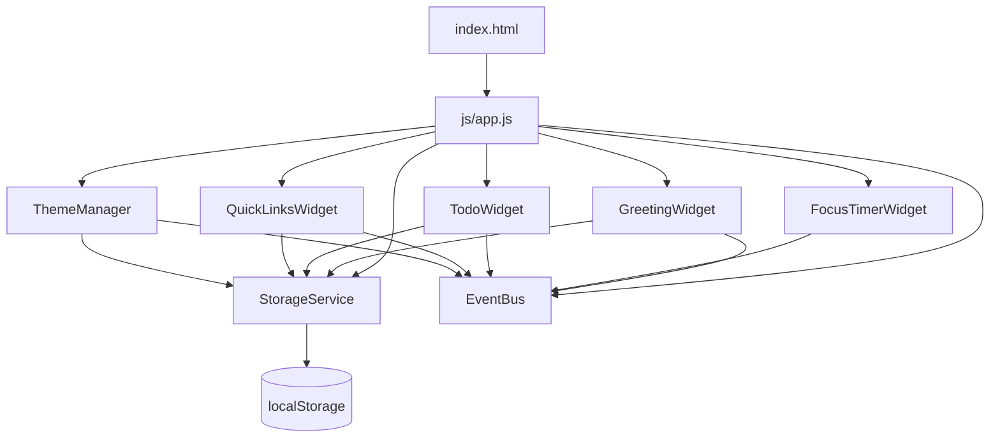
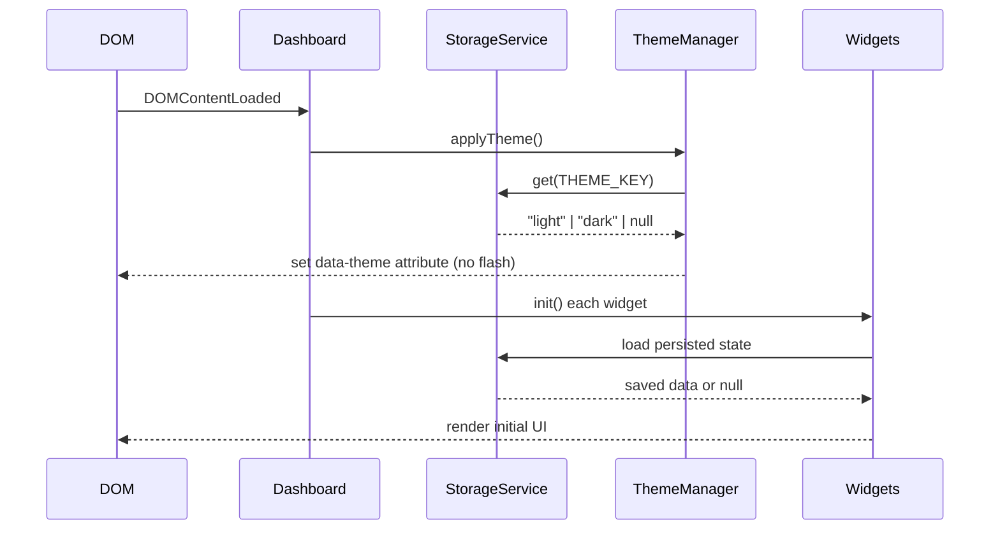
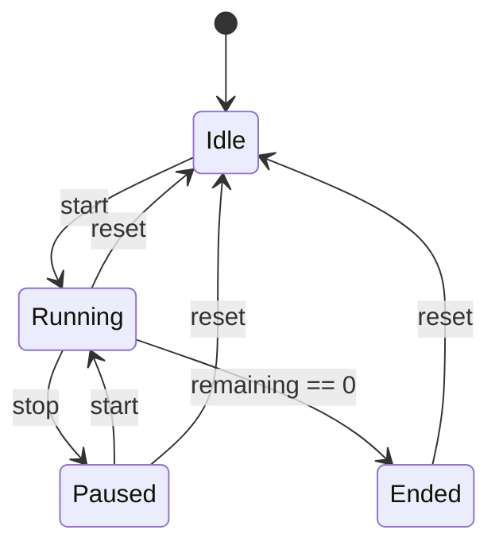

# Design Document

## Overview

The personal dashboard is a single-page application (SPA) built with vanilla HTML, CSS, and JavaScript. All logic runs in the browser; there is no backend. Data is persisted through the browser's `localStorage` API under namespaced keys. The application is deployable as a static site on GitHub Pages and can be packaged as a browser extension with minimal changes.

The app renders four widgets — Greeting, Focus Timer, To-Do List, and Quick Links — plus a Light/Dark theme toggle and a user-name setting panel. All widgets are independent UI modules that read and write through a shared Storage module.

**Key design principles:**

- **No dependencies**: Zero third-party libraries or build tools. The app ships as `index.html` + `css/styles.css` + `js/app.js`.
- **Module pattern**: Each widget is an IIFE-based module exported onto a single `Dashboard` namespace object to avoid global pollution while remaining compatible with plain `<script>` tags.
- **Storage abstraction**: All `localStorage` reads and writes go through one `StorageService` facade. If `localStorage` is unavailable the app falls back to in-memory state and shows a warning.
- **Event-driven updates**: Widgets communicate state changes through a lightweight `EventBus` (pub/sub) so they remain decoupled.

---

## Architecture

### High-Level Structure

```
index.html
├── <link rel="stylesheet" href="css/styles.css">
└── <script src="js/app.js">

js/app.js  (single concatenated file, internal module structure)
├── StorageService       – localStorage façade with namespaced keys
├── EventBus             – simple pub/sub for cross-widget events
├── ThemeManager         – reads/writes/applies Theme
├── GreetingWidget       – clock, date, greeting, user name
├── FocusTimerWidget     – countdown timer state machine
├── TodoWidget           – task CRUD, sorting, persistence
├── QuickLinksWidget     – link CRUD, validation, persistence
└── Dashboard.init()     – bootstrap: wires everything up on DOMContentLoaded
```

### Module Interaction Diagram



### Initialization Sequence



---

## Components and Interfaces

### StorageService

Wraps `localStorage` with namespaced keys and error handling.

```javascript
StorageService = {
  get(key)        → any | null,   // JSON.parse; returns null on error
  set(key, value) → boolean,      // JSON.stringify; returns false on error
  remove(key)     → void,
  isAvailable()   → boolean,
}
```

**Namespaced keys** (prefix `dashboard_`):

| Key | Value type |
|-----|-----------|
| `dashboard_theme` | `"light"` \| `"dark"` |
| `dashboard_username` | `string` |
| `dashboard_tasks` | `Task[]` |
| `dashboard_tasks_sort` | `"default"` \| `"az"` \| `"completed-last"` |
| `dashboard_links` | `Link[]` |

### EventBus

```javascript
EventBus = {
  on(event, handler)  → void,
  off(event, handler) → void,
  emit(event, data)   → void,
}
```

**Events used:**

| Event | Emitter | Payload |
|-------|---------|---------|
| `theme:changed` | ThemeManager | `{ theme: string }` |
| `username:changed` | GreetingWidget | `{ name: string }` |
| `tasks:changed` | TodoWidget | `{ tasks: Task[] }` |
| `links:changed` | QuickLinksWidget | `{ links: Link[] }` |
| `storage:error` | StorageService | `{ op: "read"\|"write", key: string }` |

### ThemeManager

```javascript
ThemeManager = {
  init()         → void,   // read from Storage, apply, attach toggle listener
  applyTheme(t)  → void,   // sets document.documentElement dataset.theme
  toggle()       → void,   // flips theme, saves, emits theme:changed
  current()      → string, // "light" | "dark"
}
```

### GreetingWidget

```javascript
GreetingWidget = {
  init()           → void,  // start clock interval, render, attach name listener
  _tick()          → void,  // called every 60 s — update time, re-evaluate period
  _getGreeting(h)  → string, // pure: hour (0-23) → "Good Morning|Afternoon|Evening|Night"
  _formatTime(d)   → string, // pure: Date → "HH:MM"
  _formatDate(d)   → string, // pure: Date → "Monday, 1 January 2025"
}
```

Time-of-day boundaries (per requirements):

| Hours | Greeting |
|-------|----------|
| 05–11 | Good Morning |
| 12–17 | Good Afternoon |
| 18–20 | Good Evening |
| 21–04 | Good Night |

### FocusTimerWidget

The timer is modeled as an explicit finite state machine.



```javascript
FocusTimerWidget = {
  init()   → void,
  start()  → void,
  stop()   → void,
  reset()  → void,
  _tick()  → void,  // called by setInterval every 1 s
  _render() → void, // update DOM from current state
}
```

State object: `{ status: "idle"|"running"|"paused"|"ended", remaining: number }` (remaining is seconds, 0–1500).

### TodoWidget

```javascript
TodoWidget = {
  init()                 → void,
  addTask(label)         → Task | ValidationError,
  editTask(id, label)    → Task | ValidationError,
  deleteTask(id)         → void,
  toggleComplete(id)     → void,
  setSortOrder(option)   → void,
  _getSorted(tasks, opt) → Task[],  // pure: returns sorted copy, no mutation
  _persist()             → void,
  _render()              → void,
}
```

### QuickLinksWidget

```javascript
QuickLinksWidget = {
  init()             → void,
  addLink(label, url) → Link | ValidationError,
  deleteLink(id)      → void,
  _validateUrl(url)   → boolean,  // pure: checks http(s):// + non-empty host
  _persist()          → void,
  _render()           → void,
}
```

---

## Data Models

### Task

```javascript
{
  id:         string,   // crypto.randomUUID() or Date.now().toString()
  label:      string,   // 1–200 characters
  completed:  boolean,  // false on creation
  createdAt:  number,   // Date.now() timestamp (ms since epoch)
}
```

### Link

```javascript
{
  id:    string,   // crypto.randomUUID() or Date.now().toString()
  label: string,   // 1–100 characters
  url:   string,   // must start with http:// or https://, non-empty host
}
```

### AppState (in-memory, not persisted as a whole)

```javascript
{
  theme:    "light" | "dark",
  username: string,          // "" when not set
  tasks:    Task[],          // insertion order; display order derived
  sortOpt:  "default" | "az" | "completed-last",
  links:    Link[],          // max 20
}
```

---

## Correctness Properties

*A property is a characteristic or behavior that should hold true across all valid executions of a system — essentially, a formal statement about what the system should do. Properties serve as the bridge between human-readable specifications and machine-verifiable correctness guarantees.*

### Property 1: Greeting time-period coverage

*For any* valid hour value (0–23), `_getGreeting(h)` SHALL return exactly one of "Good Morning", "Good Afternoon", "Good Evening", or "Good Night" — no hour is unclassified and no hour maps to two different greetings.

**Validates: Requirements 1.3, 1.4, 1.5, 1.6**

### Property 2: User name truncation invariant

*For any* saved User_Name string, the greeting displayed by `GreetingWidget` SHALL contain the User_Name truncated to at most 50 characters, preceded by ", " and the appropriate time-of-day greeting.

**Validates: Requirements 1.7, 2.1**

### Property 3: Task addition grows the list

*For any* task list and any valid (non-empty, ≤ 200 character) label, calling `addTask(label)` SHALL increase the task list length by exactly 1 and the new Task SHALL appear in the displayed list.

**Validates: Requirements 4.2**

### Property 4: Whitespace and over-length labels are rejected

*For any* string that is empty, all-whitespace, or longer than 200 characters, calling `addTask(label)` SHALL return a `ValidationError`, leave the task list unchanged, and display an inline validation message.

**Validates: Requirements 4.3, 4.4**

### Property 5: Task persistence round-trip

*For any* array of Tasks saved via `_persist()`, loading the app fresh and reading from `StorageService.get("dashboard_tasks")` SHALL return a structurally equivalent array (same ids, labels, completion states, createdAt values).

**Validates: Requirements 4.2, 4.8, 4.11, 8.3**

### Property 6: Toggle completion is an involution

*For any* Task, calling `toggleComplete` twice SHALL leave the task's `completed` field equal to its original value (i.e., `toggle(toggle(x)) === x`).

**Validates: Requirements 4.8**

### Property 7: Sort does not mutate storage order

*For any* task list and any sort option, applying `_getSorted(tasks, opt)` SHALL return a permutation of the original array — same elements, same length — without modifying the original array or the data written to Storage.

**Validates: Requirements 5.2**

### Property 8: Sorted list satisfies its ordering predicate

*For any* task list sorted with option `"az"`, every adjacent pair `(tasks[i], tasks[i+1])` SHALL satisfy `tasks[i].label.toLowerCase() <= tasks[i+1].label.toLowerCase()`. For option `"completed-last"`, no incomplete task SHALL appear after any completed task.

**Validates: Requirements 5.1, 5.2**

### Property 9: Valid links are accepted; invalid links are rejected

*For any* URL string that begins with `http://` or `https://` and has a non-empty host, `_validateUrl(url)` SHALL return `true`. *For any* URL string that does not satisfy these conditions, `_validateUrl(url)` SHALL return `false`.

**Validates: Requirements 6.2, 6.4**

### Property 10: Link persistence round-trip

*For any* array of Links saved via `_persist()`, loading the app fresh SHALL restore an equivalent array (same ids, labels, URLs) from Storage.

**Validates: Requirements 6.7, 8.3**

### Property 11: Theme toggle is an involution

*For any* active Theme, calling `ThemeManager.toggle()` twice SHALL restore the original Theme value and the `document.documentElement` dataset attribute.

**Validates: Requirements 7.1, 7.2**

---

## Error Handling

### Storage Unavailability

`StorageService.isAvailable()` is called once at startup using a test write/read/delete cycle. If it throws or returns `false`:

1. The app emits `storage:error` on the EventBus.
2. A visible warning banner is rendered at the top of the page: "Local storage is unavailable — your data will not be saved."
3. All widgets fall back to in-memory defaults: tasks `[]`, links `[]`, User_Name `""`, Theme `"light"`.
4. All subsequent `StorageService.set()` calls are no-ops and return `false`; no additional banners are shown per write failure.

If `localStorage` is available at startup but a later `set()` call throws (e.g., quota exceeded):

1. `StorageService.set()` catches the error and returns `false`.
2. The emitter receives `false` and shows a one-time inline notification: "Could not save changes — storage may be full."
3. The in-memory state is not rolled back; the user can continue using the session.

### Input Validation Errors

Each widget validates user input before mutating state. Validation errors are displayed as inline messages adjacent to the relevant form field. They are cleared on the next successful submission or when the input changes.

| Widget | Trigger | Message |
|--------|---------|---------|
| TodoWidget | Empty label | "Task cannot be empty." |
| TodoWidget | Label > 200 chars | "Task must be 200 characters or fewer." |
| QuickLinksWidget | Empty label | "Label is required." |
| QuickLinksWidget | Invalid URL | "URL must start with http:// or https:// and include a host." |
| QuickLinksWidget | 20 links reached | "Maximum of 20 links reached." |

### Focus Timer Edge Cases

- The timer uses `setInterval`. If the browser throttles the interval (e.g., tab is backgrounded), the displayed remaining time may drift slightly; this is acceptable browser behavior and not treated as an error.
- Double-clicking Start while already running: the FSM checks `status !== "running"` before transitioning; duplicate starts are silently ignored per Requirement 3.9.

### Browser Compatibility

No polyfills are included; the app targets browsers that natively support `localStorage`, `const`/`let`, arrow functions, `Array.prototype` methods (`map`, `filter`, `sort`), and `crypto.randomUUID` (or falls back to `Date.now().toString()` if `crypto.randomUUID` is absent).

---

## Testing Strategy

### Approach

The testing strategy uses two complementary layers:

1. **Property-based tests** — verify universal invariants across random inputs using [fast-check](https://fast-check.dev/) (JavaScript, browser and Node compatible, zero additional runtime dependency in production).
2. **Example-based unit tests** — verify specific scenarios, edge cases, and error conditions using [Vitest](https://vitest.dev/) as the test runner.

Both layers target the pure logic functions extracted from each module. DOM-dependent rendering logic is tested with example-based tests using JSDOM (provided by Vitest's `environment: "jsdom"` mode).

### Property-Based Tests (fast-check, minimum 100 iterations each)

Each test is tagged with the property it validates.

| Test | Property | Tag |
|------|----------|-----|
| `_getGreeting` covers all 24 hours | Property 1 | `Feature: personal-dashboard, Property 1: greeting time-period coverage` |
| Greeting contains truncated name | Property 2 | `Feature: personal-dashboard, Property 2: user name truncation invariant` |
| `addTask` grows list by 1 | Property 3 | `Feature: personal-dashboard, Property 3: task addition grows the list` |
| Invalid labels rejected | Property 4 | `Feature: personal-dashboard, Property 4: whitespace and over-length labels are rejected` |
| Task storage round-trip | Property 5 | `Feature: personal-dashboard, Property 5: task persistence round-trip` |
| `toggleComplete` twice = identity | Property 6 | `Feature: personal-dashboard, Property 6: toggle completion is an involution` |
| `_getSorted` returns permutation | Property 7 | `Feature: personal-dashboard, Property 7: sort does not mutate storage order` |
| Sorted list satisfies predicate | Property 8 | `Feature: personal-dashboard, Property 8: sorted list satisfies its ordering predicate` |
| `_validateUrl` accept/reject | Property 9 | `Feature: personal-dashboard, Property 9: valid links accepted, invalid rejected` |
| Link storage round-trip | Property 10 | `Feature: personal-dashboard, Property 10: link persistence round-trip` |
| `toggle()` twice = identity | Property 11 | `Feature: personal-dashboard, Property 11: theme toggle is an involution` |

### Example-Based Unit Tests (Vitest)

- **StorageService**: unavailable storage falls back to defaults; `set()` quota error shows warning.
- **GreetingWidget**: displays correct greeting at boundary hours (05:00, 12:00, 18:00, 21:00, 04:59); appends name when User_Name set; omits name when empty.
- **FocusTimerWidget**: initial display is "25:00"; start→stop→start resumes from paused time; reset from running returns to 25:00; completion fires notification.
- **TodoWidget**: edit saves new label; editing to empty retains original; delete removes task; sort preference persists across reload; empty list disables sort control.
- **QuickLinksWidget**: valid link opens in new tab (`target="_blank"`); 21st link is rejected; delete removes correct link by id.
- **ThemeManager**: default theme is `"light"` when nothing stored; toggle applies `data-theme` attribute within same tick; saved theme is applied before first paint.
- **Integration smoke**: `Dashboard.init()` with a mocked `localStorage` containing all keys renders all four widgets with the correct saved state.

### Responsiveness and Visual

Automated layout tests are out of scope for the unit layer. Responsive behavior (320px–1920px viewport) should be verified manually or through visual regression tooling (e.g., Percy or Playwright screenshots) as a separate step.

### Running Tests

```
# Install dev dependencies (not shipped to production)
npm install --save-dev vitest fast-check jsdom

# Run all tests once
npx vitest --run
```

No build step is needed for production. The test toolchain is dev-only.
